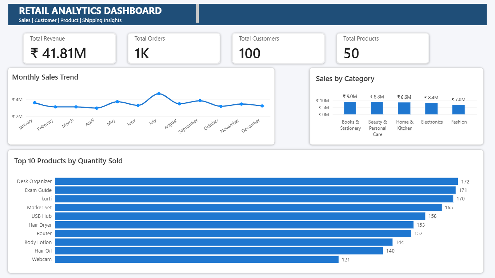
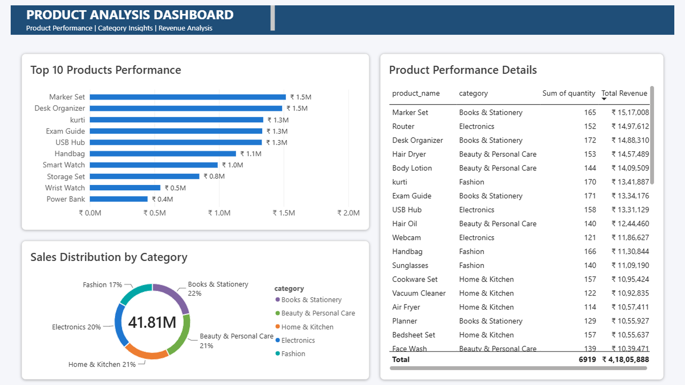
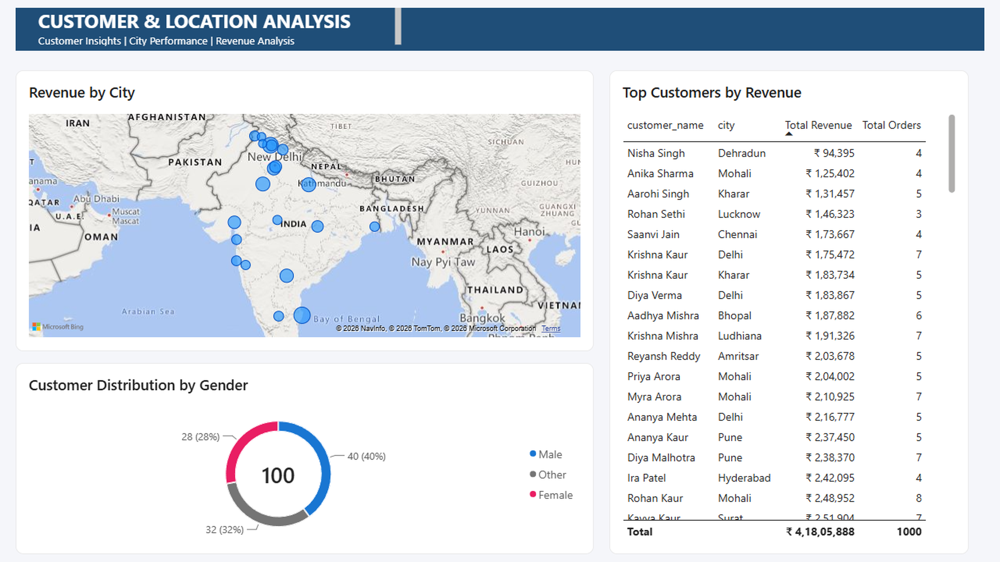
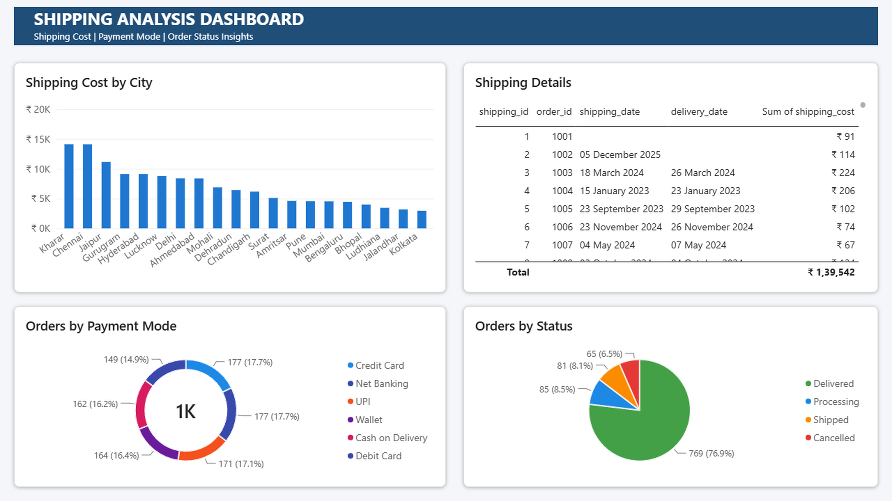

# Retail Sales & Business Intelligence Analytics System


## 📌 Project Overview

Retail Sales & Business Intelligence Analytics System is a data analytics project focused on analyzing retail transaction data and generating business insights using **MySQL, SQL, and Power BI**.

The project helps understand sales performance, product trends, customer behavior, payment methods, and delivery efficiency through data-driven reporting.

---

## 🎯 Business Objectives

This project answers important business questions:

- Which products generate the highest revenue?
- Which categories perform better?
- Which cities generate maximum sales?
- Who are the high-value customers?
- Which payment methods are most used?
- How efficient is the delivery process?

---

## 🛠️ Tools & Technologies

| Tool        | Usage                              |
| ----------- | ---------------------------------- |
| MySQL       | Database creation and management   |
| SQL         | Data analysis and business queries |
| Power BI    | Interactive dashboard creation     |
| Excel / CSV | Data source and import             |

---

# 🗄️ Database Design

**Database Name:**

```
retail_analytics
```

## Tables

### 1. Customers

Columns:

- customer_id
- customer_name
- gender
- city
- state
- registration_date

### 2. Products

Columns:

- product_id
- product_name
- category
- price
- cost_price

### 3. Orders

Columns:

- order_id
- customer_id
- order_date
- order_status
- payment_mode

### 4. Order Details

Columns:

- details_id
- order_id
- product_id
- quantity
- unit_price
- discount

### 5. Shipping

Columns:

- shipping_id
- order_id
- shipping_date
- delivery_date
- shipping_cost

---

# 📊 SQL Analysis

SQL analysis performed:

- Total Revenue Calculation
- Top Selling Products
- Category-wise Sales Analysis
- City-wise Revenue Analysis
- Monthly Sales Trend
- Customer Analysis
- Product Performance Analysis

SQL concepts used:

- Joins
- Aggregations
- GROUP BY
- ORDER BY
- Business KPI calculations

---

# 📈 Power BI Dashboard

The dashboard contains 4 analytical pages:

## 1. Executive Overview

Includes:

- Total Revenue
- Total Orders
- Total Customers
- Total Quantity Sold
- Monthly Sales Trend
- Category Performance
- Top Products

## 2. Product Analysis

Includes:

- Revenue by Product
- Top Performing Products
- Category-wise Sales
- Product Contribution

## 3. Customer & Location Analysis

Includes:

- Customer Analysis
- City-wise Revenue
- Customer Distribution
- Gender Analysis

## 4. Shipping Analysis

Includes:

- Payment Mode Analysis
- Order Status Analysis
- Shipping Cost Analysis
- Delivery Details

---

# 📷 Dashboard Screenshots

## Executive Overview



## Product Analysis



## Customer & Location Analysis



## Shipping Analysis



---

# 📁 Project Structure

```text
Retail-Sales-BI-Analytics
│
├── SQL
│   ├── 01_Database_Design.sql
│   ├── 02_Data_Import.sql
│   └── 03_Analysis_Queries.sql
│
├── PowerBI
│   └── Retail_Analytics_PowerBI_Dashboard.pbix
│
├── Screenshots
│   ├── Executive_Overview.png
│   ├── Product_Analysis.png
│   ├── Customer_Location_Analysis.png
│   └── Shipping_Analysis.png
│
└── README.md
```

---

# 💡 Key Insights

- Identified top revenue-generating products
- Analyzed category performance
- Compared city-wise sales performance
- Studied customer purchasing patterns
- Evaluated payment and delivery trends

---

# 📌 Dataset Note

Raw dataset files are not included in this repository.

Data was imported into MySQL database and used for SQL analysis and Power BI dashboard development.

---

# 👨‍💻 Author

**Vineet Shukla**

Data Analytics Portfolio Project
